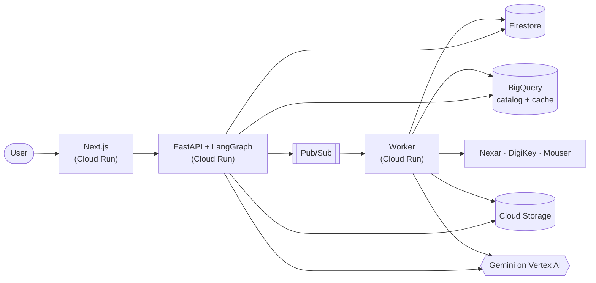

# QuoteLens

**Evidence-backed BOM → quotation copilot for electronics manufacturing (EMS) and sourcing teams.**

Built for **AI Builder Cup 2026**, Manufacturing: Intelligent Operations & Industrial Efficiency. Deployed on **Google Cloud**.

> **Status:** Feature-complete (Phases 0–8, live distributor data, deployment code). Deployment to GCP is pending the free-trial project; see the open `needs-real-env` issues.

---

## The problem
Turning a customer BOM/RFQ into a quote takes days of manual work:
- Cleaning messy spreadsheets
- Checking every part across distributors
- Spotting EOL, long-lead or single-source parts
- Working out MOQ, scrap and excess cost
- Hunting for alternates

The result is hard to defend, because nobody can easily show *where each number came from*.

## What QuoteLens does
Upload a BOM and get a **defensible quote**. Every value is labelled **Actual · Calculated · Assumed · Unavailable · Recommended** and links to its evidence.

| # | Capability | What you get |
|---|---|---|
| 1 | **BOM upload and quick quote** | AI-assisted column mapping, normalization, validation, instant first-pass quote, inline corrections |
| 2 | **Distributor pricing and component details** | Multi-distributor offers (stock, MOQ, lead time, price breaks, lifecycle) with the source and freshness of each value |
| 3 | **Explainable BOM risk** | EOL/NRND, single source, lead time, price outliers, data issues. Each risk explains *why*, with evidence, and can be resolved or waived. |
| 4 | **Manufacturing impact** | MOQ, scrap/attrition, excess/shortage and price-break effects per build volume, with a calculation trace |
| 5 | **Evidence-backed copilot** | Chat over the project data. Answers cite their sources, and numbers are checked against the data. |
| 6 | **Alternative parts** | Parameter-by-parameter comparison, fit class and explanation. A person must approve before any swap. |
| 7 | **Cloud deployment and demo readiness** | Runs end to end on Cloud Run, with sample BOMs and a guided demo mode |

**Demo journey:** upload BOM → pricing → risks → manufacturing impact → alternatives → copilot → finalized quote

## Architecture at a glance

**Design principle:** a deterministic core with the LLM at the edges. Plain, tested code calculates every price, risk and impact number. Gemini maps columns, explains results, investigates alternates and powers the copilot. It never produces the financial numbers.

## Tech stack
| Layer | Technology |
|---|---|
| Frontend | Next.js (App Router, TypeScript), Tailwind, shadcn/ui, TanStack Query/Table |
| Backend | Python 3.12, FastAPI, Pydantic v2, LangChain + LangGraph |
| AI | Gemini on Vertex AI |
| Data | Firestore (app state), BigQuery (component catalog, price cache, analytics), Cloud Storage (files) |
| Async | Pub/Sub → Cloud Run worker (inline fallback) |
| Ops | Cloud Run, Cloud Build, Artifact Registry, Secret Manager, Cloud Logging |

## Documentation
Everything is in [`docs/`](docs/README.md):

| Document | Description |
|---|---|
| [Architecture](docs/architecture.md) | Context, system and module diagrams, pipeline sequence |
| [High-Level Design](docs/hld.md) | Fact/Evidence model, modules, state machine, NFRs, deployment |
| [Low-Level Design](docs/lld.md) | Repo layout, data models, storage schemas, algorithms, risk rules, testing, sample data |
| [User Flows](docs/user-flows.md) | First-time viewer plus 4 personas |
| [Competitor Analysis](docs/competitor-analysis.md) | Market landscape and differentiation |
| [API Contract](docs/api-contract.md) · [OpenAPI](docs/openapi.yaml) | 35 endpoints, error model, SSE copilot stream |
| [ADRs](docs/adr/) | Architecture decision records |
| [Implementation Plan](docs/implementation-plan.md) | Phases 0–9, milestones, team tracks, cut list, verification |
| [Demo runbook](docs/demo-runbook.md) | 6-minute walkthrough, pre-demo checklist, fallbacks |
| [Local testing](docs/local-testing.md) | Run locally against the real distributor APIs and an LLM via OpenRouter |

## Repository layout (planned)
```
apps/web/          Next.js frontend
services/api/      FastAPI api + worker (shared codebase)
data/samples/      Sample BOMs + golden expected outputs
data/catalog_seed/ Curated component catalog for BigQuery
infra/             Cloud Build, deploy scripts, schemas
docs/              Design documentation
```

## Getting started
Prerequisites: Python 3.12 via [uv](https://docs.astral.sh/uv/), Node 20+, pnpm 11, and the `gcloud` CLI (for deployment only).

```bash
# Backend: runs fully offline by default (in-memory store, inline jobs)
cd services/api && uv sync && cp .env.example .env
uv run uvicorn app.main_api:app --reload --port 8080      # http://localhost:8080/healthz
uv run pytest

# Frontend
cd apps/web && pnpm install && pnpm dev                    # http://localhost:3000
```

**Test locally with the real APIs** (DigiKey, Mouser, element14, and Gemini through OpenRouter): see [docs/local-testing.md](docs/local-testing.md).

**Deploy to GCP (free credits)**, from the repo root in Git Bash, in this order:
1. `PROJECT_ID=<id> BILLING_ACCOUNT=<id> BUDGET_CURRENCY=<USD|INR> ./infra/bootstrap.sh` (once): enables the APIs and creates service accounts, Firestore, the bucket, BigQuery, Pub/Sub, Artifact Registry and budget alerts.
2. `cd services/api && uv run python scripts/load_catalog.py --project <id>` (optional, for `CATALOG_BACKEND=bigquery`).
3. `PROJECT_ID=<id> ./infra/secrets.sh`: copies the distributor keys from `services/api/.env` to Secret Manager.
4. `PROJECT_ID=<id> ./infra/deploy.sh`: builds both images with Cloud Build and deploys web (public), api and worker (private), plus the Pub/Sub push subscription.
5. Demo day: `./infra/demo-mode.sh on|off` and the [demo runbook](docs/demo-runbook.md). Afterwards: `./infra/teardown.sh`. Daily: [`infra/cost-check.md`](infra/cost-check.md).

## Team
Team **miscellaneous**, AI Builder Cup 2026.
