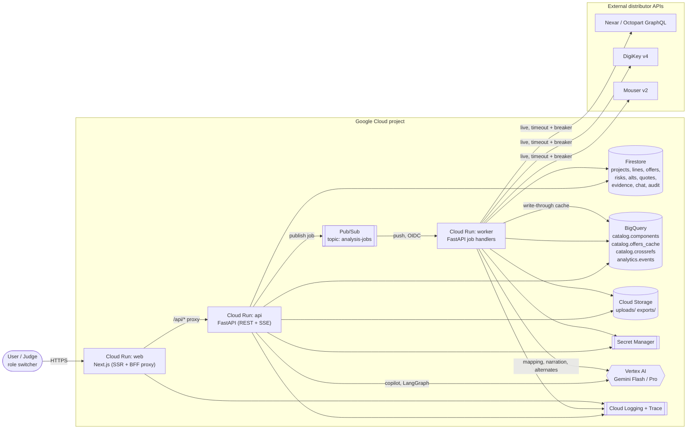
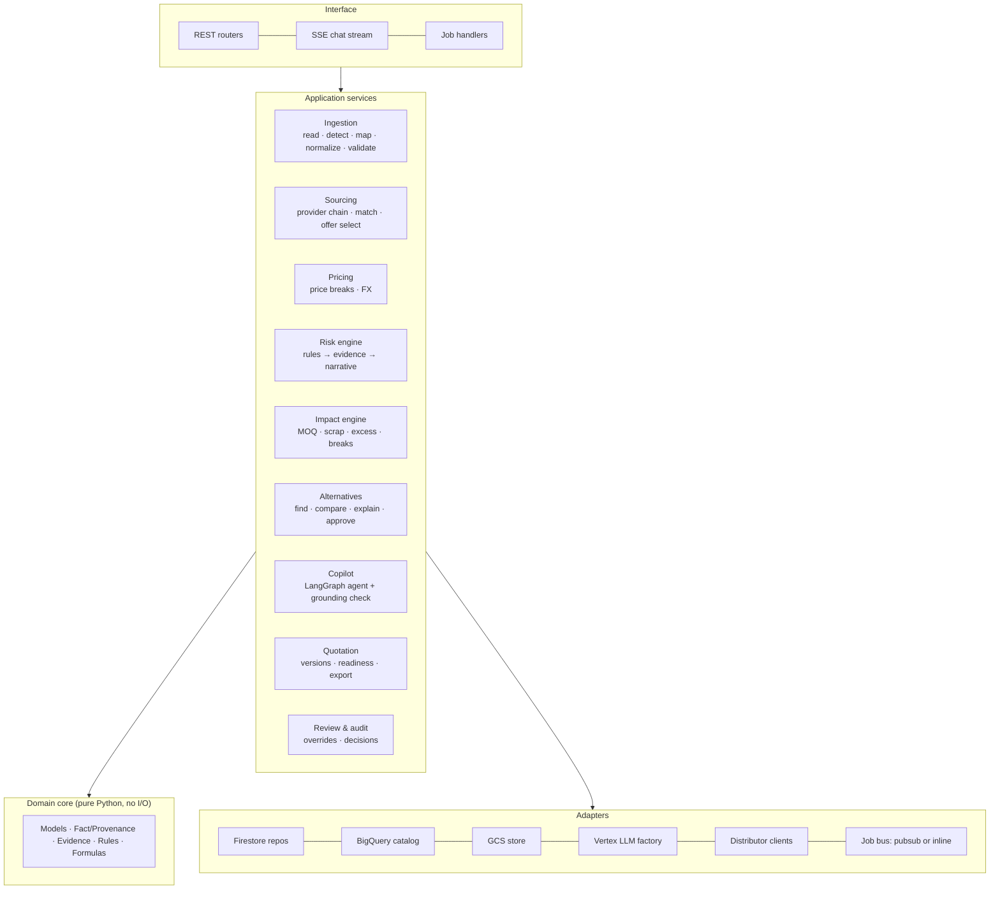
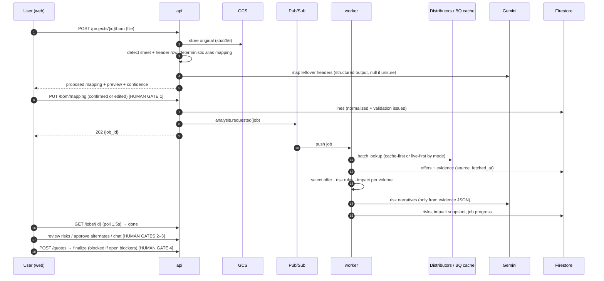

# Architecture

> QuoteLens · AI Builder Cup 2026 · Manufacturing track. Part of the design package; see [README](README.md).

## 0. Context

EMS and sourcing teams lose days turning a customer BOM/RFQ into a quote. The work is cleaning messy spreadsheets, checking each part across distributors, spotting EOL or long-lead parts, working out MOQ, scrap and excess cost, and finding alternates. Today it happens in Excel plus several browser tabs, and it is hard to justify the numbers to a customer or manager afterwards.

QuoteLens turns a BOM into a quote you can defend. Every number carries a provenance tag (**Actual · Calculated · Assumed · Unavailable · Recommended**) and links to its evidence. Risks are explained, not just scored. A person approves every important decision.

**Demo journey (the hero flow):** upload BOM → map and validate → distributor pricing → explainable risks → manufacturing impact → alternative-part investigation → copilot Q&A → finalized quote.

### Confirmed decisions
| Topic | Decision |
|---|---|
| Frontend | Next.js (App Router, TypeScript) |
| Backend | Python 3.12, FastAPI, LangChain + LangGraph |
| LLM | Gemini on Vertex AI. Flash for extraction and narration, Pro for the copilot and alternates. Model IDs come from env config. |
| App state | Firestore (native mode) |
| Catalog, price cache, analytics | BigQuery |
| Files | Cloud Storage (uploads, exports) |
| Async jobs | Pub/Sub push to a worker on Cloud Run, with an inline fallback for local runs and demo safety |
| Secrets | Secret Manager (distributor API keys) |
| Hosting | Cloud Run: `web`, `api`, `worker`. Images in Artifact Registry, built by Cloud Build. |
| Distributor data | Hybrid. Live Nexar/Octopart, DigiKey and Mouser when keys exist, with fallback to a curated BigQuery catalog. Every value carries its source and `fetched_at`. |
| Auth | None. A UI role switcher (Sourcing, Quote Engineer, Engineering, Manager, first-time viewer). Role is sent as the `X-Demo-Role` header and used only for the audit trail. |
| Docs | Markdown and Mermaid in `docs/`, plus `openapi.yaml` generated from FastAPI |

### Reference code (`BuLLMQuote_SRIM-main`): borrow ideas, rewrite cleanly
- **Borrow (re-implemented and tested):**
  - Unit normalization maps
  - LLM header-mapping pattern: fixed field list, null if unsure, deterministic rules override (`intake/bom_processing.py:111`)
  - Hierarchy quantity roll-up (`bom_processing.py:430-600`)
  - "Consolidate by MPN, refuse mixed units"
  - `select_price_for_qty`, `effective_moq` (`distributor-pricing/models.py`, `enrichment.py:36`)
  - Scrap tiers (`scrap_factor.py`)
  - The six-step excess chain (`queries.py:755-823`)
  - DigiKey OAuth and Cut-Tape handling
  - Element14 status maps
  - Missing-Notes sections as a starting list of risk rules
  - Chat ideas: sentinel no-answer, citations taken from retrieval
  - UI ideas: quality tiles and sticky manual-edit highlights
- **Avoid:**
  - Dify, MCP Jungle and Postgres routing loops
  - DuckDB as a shared store
  - Wide per-distributor columns (we use normalized `offers`)
  - Hardcoded currency rates and paths
  - Swallowed errors reported as success
  - f-string SQL
  - Committed secrets and customer data
  - Cheapest-price-only selection
  - **Anything Gerber/PCB-related.** It is out of scope, and nothing from `gerber-integration/` is reused. Column aliases, header-row detection, refdes expansion and the package-attrition table are written fresh.

---

## 1. Architecture diagram

### 1.1 System context and containers (GCP)

### 1.2 Logical modules (modular monolith; `api` and `worker` share one codebase and image)

### 1.3 Analysis pipeline (sequence)

