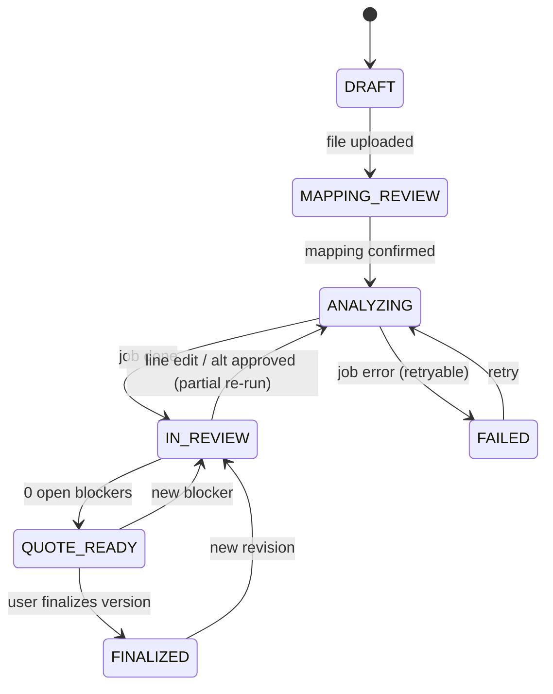
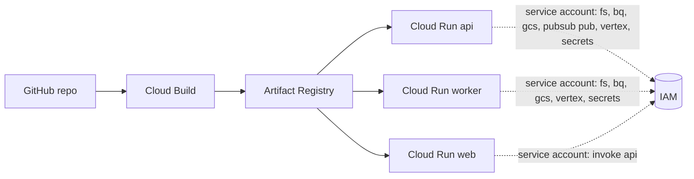

# High-Level Design (HLD)

> QuoteLens · AI Builder Cup 2026 · Manufacturing track. Part of the design package; see [README](README.md).

## 2. High-level design (HLD)

### 2.1 Goals and non-goals
- **Goals:**
  - The full 7-capability journey works end to end on Cloud Run.
  - Every number is explainable.
  - A person reviews every important decision.
  - The live demo is reliable even if external APIs or the LLM are unavailable.
- **Non-goals (hackathon):**
  - Real authentication or multi-tenancy
  - ERP integration
  - PCB fabrication and assembly labor costing beyond simple user-entered assumptions
  - Multi-level BOM explosion beyond one level (roll-up supported if a level column exists; stretch)

### 2.2 Core concept: the Fact and Evidence model
Each value shown in the UI or returned by the API is a `Fact`:

```
Fact { value, unit?, provenance: ACTUAL | CALCULATED | ASSUMED | UNAVAILABLE | RECOMMENDED,
       evidence_ids[], formula?, assumption_note? }
Evidence { id, kind: DISTRIBUTOR_OFFER | CATALOG_SNAPSHOT | BOM_CELL | USER_OVERRIDE | RULE_EVAL | CALC_TRACE,
           source_name, source_ref (sku/url/sheet!cell), fetched_at, mode: LIVE | CACHE | DEMO_SNAPSHOT, payload_excerpt }
```

- **Actual:** comes from a source (BOM cell, distributor, catalog).
- **Calculated:** produced by a formula over Actual and Assumed inputs, with the formula trace stored.
- **Assumed:** a default or user-entered parameter, such as scrap %, markup or FX rate.
- **Unavailable:** shown explicitly as "—, no source". It is never filled with a guess.
- **Recommended:** a system suggestion, such as the best offer or an alternate. It needs human acceptance.

The UI renders a provenance badge on every value. Clicking it opens the Evidence drawer.

### 2.3 Module responsibilities
| Module | Responsibility | AI usage |
|---|---|---|
| Ingestion | Read XLSX/CSV/TSV. Detect sheet and header row. Map columns (aliases first, Gemini for the rest). Normalize MPN, manufacturer, qty, UOM and refdes. Validate. Consolidate duplicates. | Gemini Flash for header mapping and manufacturer alias normalization (structured output) |
| Sourcing | Provider chain (Nexar → DigiKey → Mouser → BQ catalog). MPN matching (exact, then normalized, then ambiguous). Normalized `Offer` records. Best-offer recommendation with reasons. | None (deterministic) |
| Pricing | Price-break selection at the buy quantity, FX conversion (rate stored as an Assumed fact with its date) | None |
| Risk | ~20 rules → `Risk{severity, evidence, explanation, actions}`. BOM-level readiness and spend-at-risk. | Gemini Flash only rewrites the rule output as plain language. Deterministic template fallback. |
| Impact | Per line and per volume: required → gross (scrap) → buy (MOQ/SPQ) → excess/shortage → extended cost. Price-break jump optimization. Roll-up and contribution %. | None |
| Alternatives | Candidates from Nexar similar parts, DigiKey substitutions and BQ cross-refs. Parametric comparison. Fit class. Explanation. Approval workflow. | LangGraph sub-agent (Gemini Pro) explains suitability from the comparison table only |
| Copilot | Chat over project data through read-only tools plus a what-if tool. Citations required. Numeric grounding check. | LangGraph ReAct agent (Gemini Pro) |
| Quotation | Versioned snapshot per volume, readiness gates, finalize, XLSX export | None |
| Review & audit | Line overrides (old/new/reason/role), risk status changes, alternate decisions, offer selection changes | None |

### 2.4 Project lifecycle (state machine)


### 2.5 Key architecture decisions (ADRs, short form)
1. **Modular monolith, 3 Cloud Run services from one backend image.** A 2-day build cannot afford microservice overhead, and module boundaries still keep the code clean.
2. **Deterministic core, LLM at the edges.** Pricing, risk detection and impact math are plain Python, unit-tested and explainable. Gemini only maps headers, phrases explanations, investigates alternates and chats. If an LLM call fails, the result degrades to a template; it never becomes wrong.
3. **LangGraph only where reasoning loops exist** (copilot, alternates investigation). The analysis pipeline is an explicit staged job with progress in Firestore. That is simpler to debug, and the human gates are handled by the project state machine.
4. **Normalized offers, not wide columns.** One `Offer` per (line, distributor, SKU) lets us compare any number of sources.
5. **Hybrid data with explicit mode.** `DATA_MODE = live_first | cache_first | demo_snapshot`. The demo runs `cache_first` with a warmed cache, so live calls are a bonus, not a dependency. The UI shows LIVE, CACHE or SNAPSHOT plus the age on every offer.
6. **Pub/Sub plus inline fallback.** `JOB_BACKEND=pubsub|inline` behind one `JobBus` interface. Locally, and as a demo escape hatch, jobs run in-process.
7. **OpenAPI-first contract.** FastAPI's Pydantic models are the source of truth, and the frontend types are generated with `openapi-typescript`.

### 2.6 Non-functional requirements
| NFR | Target / approach |
|---|---|
| Demo reliability | Cloud Run min-instances=1 for web and api **during the demo window only** (0 otherwise, to save free credits). Cache pre-warmed for the sample BOMs. Per-provider timeout of 4s plus a circuit breaker. LLM timeout with template fallback. A seeded "demo project" restorable with one click. |
| Latency | Upload and mapping preview under 3s. 60-line BOM analysis under 30s in cache-first mode. First copilot token under 3s. |
| Explainability | 100% of displayed numbers carry provenance. Every risk has at least one evidence item. Every copilot answer with numbers carries citations. |
| Data integrity | Firestore transactions for overrides and decisions. Quote versions are immutable snapshots. Original files are kept in GCS with sha256. |
| Security (no auth) | Secrets in Secret Manager. Nothing sensitive in the repo. CORS limited to the web origin. The api is called only through the web BFF; the worker accepts only Pub/Sub OIDC. Uploads capped at 5MB and limited to .xlsx/.csv/.tsv. Formulas are not evaluated (openpyxl `data_only`). BOM text is passed to the LLM as delimited data, never as instructions (prompt-injection guard). |
| Observability | Structured JSON logs with `request_id`, `project_id` and `job_id`. LLM calls logged with model, latency and token counts. `/healthz` and `/readyz`. |
| Cost (**GCP free credits only**) | Stay within the Always Free tiers; Vertex AI Gemini is the only meaningful draw on the credit. Flash by default, with token caps, caching and an `LLM_ENABLED` kill switch. BigQuery queries batched per BOM (one `IN UNNEST(@mpns)` query) and loaded by load jobs. Everything scales to zero, with `max-instances` caps and budget alerts. No Dataflow, Cloud SQL, GKE or load balancers. See the [free-credit cost plan](implementation-plan.md#free-credit-cost-plan). |

### 2.7 Deployment view

