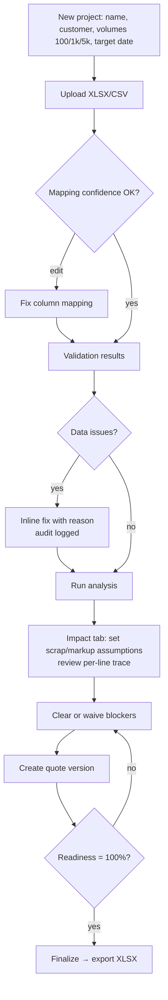
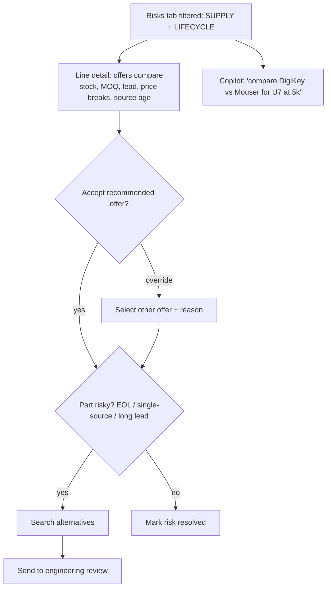
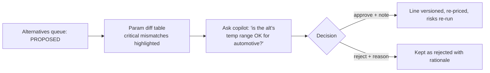
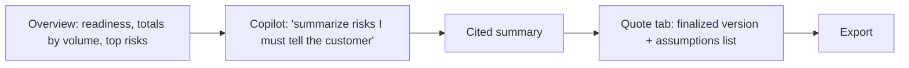

# User Flows

> QuoteLens · AI Builder Cup 2026 · Manufacturing track. Part of the design package; see [README](README.md).

## 4. User flows

### Personas
| Persona | Goal | Primary screens |
|---|---|---|
| **P0 First-time viewer / judge** | See the value in under 3 minutes | Landing → Guided demo |
| **P1 Sourcing / procurement specialist** | Best compliant source, availability, cost | Sourcing, Risks, Alternatives, Copilot |
| **P2 Quote / cost engineer (EMS)** | An accurate, defensible quote per volume | Upload, Map, BOM, Impact, Quote |
| **P3 Design / NPI engineer** | Approve or reject alternates technically | Alternatives, Copilot |
| **P4 Sales / program manager** | Know quote readiness and the risks to tell the customer | Overview, Quote, Copilot |

### P0 Generalized first-time viewer (guided demo)

```mermaid
flowchart LR
  A[Landing: problem + 'Run guided demo'] --> B[Seed sample BOM<br/>motor-controller, 60 lines]
  B --> C[Mapping preview<br/>tour: AI mapped 9/10 columns, confirm]
  C --> D[Analysis progress<br/>live/cache chips]
  D --> E[Overview: readiness 62%<br/>3 blockers, 18% spend at risk]
  E --> F[Open blocker: EOL part<br/>Why + evidence]
  F --> G[Alternatives: drop-in found<br/>approve]
  G --> H[Impact: MOQ excess<br/>price-break jump saves X]
  H --> I[Copilot: 'Which parts threaten a<br/>6-week delivery?' → cited answer]
  I --> J[Quote: readiness 100%<br/>finalize + export]
```

### P2 Quote engineer (core path)

### P1 Sourcing specialist

### P3 Design / NPI engineer

### P4 Sales / program manager

